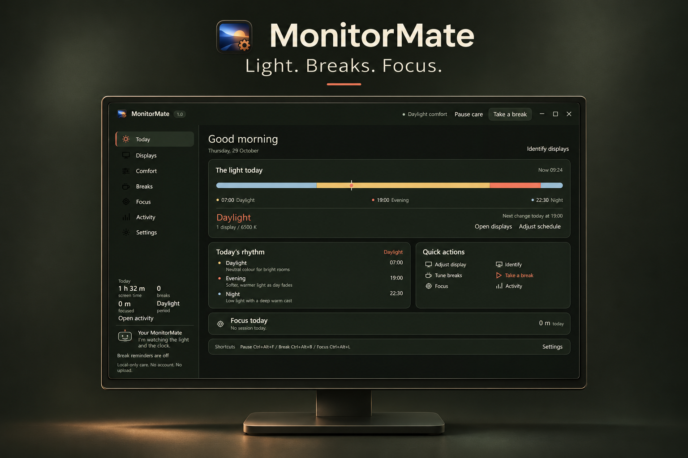
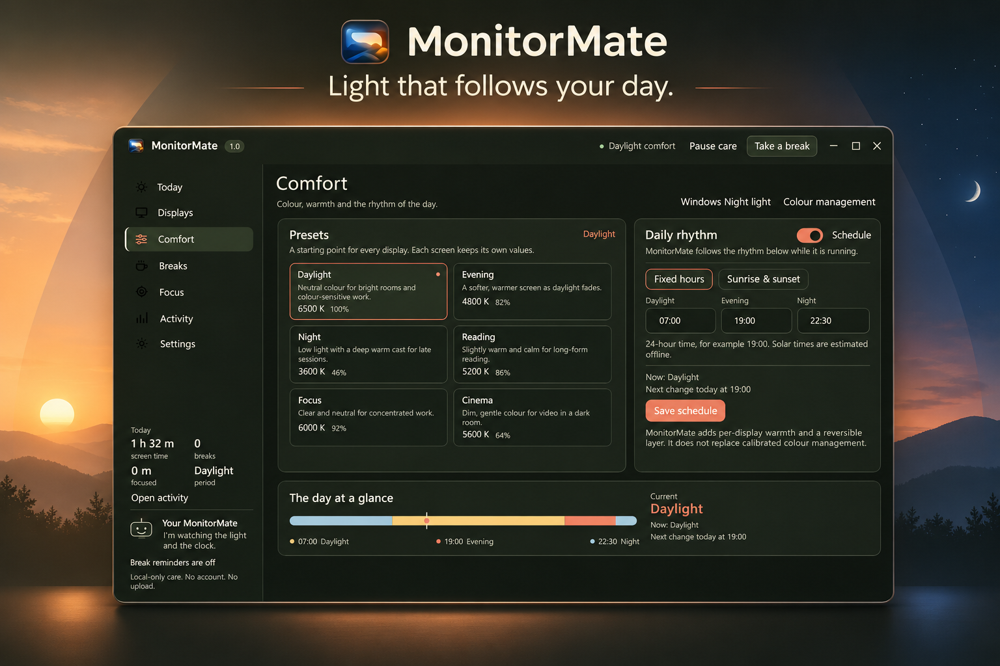
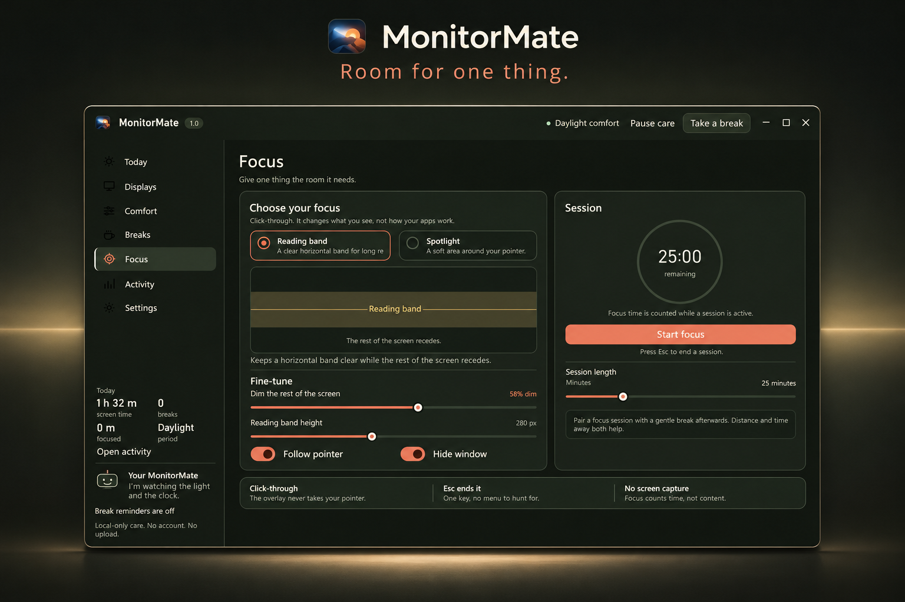
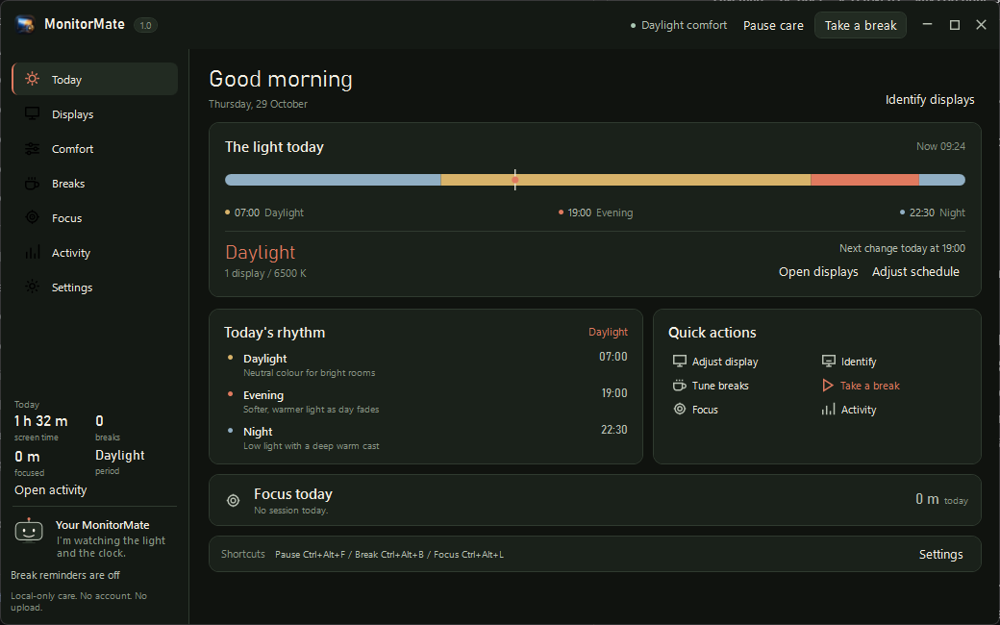

# MonitorMate

**Thoughtful display comfort for long days at the screen.**

[](RELEASE_NOTES.md)
[](docs/INSTALLATION.md)
[](LICENSE)
[](src/MonitorMate/MonitorMate.csproj)
[](PRIVACY.md)
[](docs/CROSS_PLATFORM.md)

[Features](#features) · [Build and run](#build-and-run) · [Platform support](#platform-support) ·
[Preview notes](RELEASE_NOTES.md) · [Documentation](docs/DOCUMENTATION_INDEX.md) · [Support](SUPPORT.md)

MonitorMate brings monitor brightness, colour warmth, break reminders and focus
overlays into one compact desktop window. It is built for people who spend long
sessions at a screen and want direct controls, fewer interruptions and a clear
view of their work rhythm.

Created and maintained by **Benedictus RH ([@benedictusrey](https://github.com/benedictusrey))**.



*Promotional illustration based on the app. The authentic interface capture appears below.*

> **v1.0.0 GitHub preview.** Windows includes display controls, reminders and focus.
> Linux and macOS have a smaller reminder app with explicit capability limits.
> Packages are unsigned or ad-hoc signed. This is a feedback preview with no timed
> trial. Read [installation](docs/INSTALLATION.md) and [verification](docs/UI_AUDIT.md)
> before using it. [Release page](https://github.com/benedictusrey/MonitorMate/releases/tag/v1.0.0).

## Windows features

| Area | What MonitorMate adds |
|---|---|
| Display controls | Per-display hardware brightness and opt-in contrast over DDC/CI where supported; software dimming where gamma control is available. |
| Comfort presets | Daylight, Evening, Night, Reading, Focus and Cinema, with adjustable warmth and extra dim. |
| Daily rhythm | Fixed-hour scheduling or offline sunrise/sunset estimates from coordinates you enter. |
| Break reminders | 20-20-20, Pomodoro, Deep work and custom timing, with gentle, full-screen and strict scheduled reminders. |
| Focus sessions | A click-through reading band or spotlight, adjustable surrounding dim and a session timer. |
| Activity | Aggregate screen, break and focus totals stored on your PC while MonitorMate runs. |
| Desktop integration | Tray controls, global shortcuts, close-to-tray and display identification. |

Hardware support varies by monitor, cable, adapter and driver. Gamma controls
are not a replacement for calibrated colour management or HDR controls.

On first launch, choose **Use manually** or **Enable automatic**. Manual mode
keeps presets, supported display controls and reminders available without scheduled,
startup or resume changes. Enabling automatic changes asks for confirmation;
declining keeps manual mode available. See [display-control choices](docs/adr/0004-first-run-consent.md).

## Light that follows your day



Start with a preset, then adjust your display settings. Schedule changes by fixed
hours or estimate daylight from manually entered coordinates. Warmth and software
dimming are composed from a stored gamma baseline rather than repeatedly stacking
new adjustments on the previous tint.

Pause and normal exit attempt to restore that baseline. Driver failures and forced termination still limit restoration guarantees.
The candidate repairs own-tint recapture and restart cleanup ordering; real-monitor validation remains pending.

*Generated illustration. Small labels and values may differ from the saved capture;
see [image provenance](docs/IMAGE_ASSETS.md).*

## Give one task your attention



Keep a reading band or spotlight clear while the surrounding screen recedes.
The overlay does not intercept pointer clicks. Pair a session with a break rhythm,
or start a break when you need one. Manually started breaks remain skippable,
including when strict scheduling is selected.

Esc normally ends focus when Windows registers the key. The candidate preserves that registration when shortcuts change.
The Focus page and tray provide other exits.

*Generated illustration based on the saved Focus page, not a new runtime test.*

## Actual interface



The saved Today capture shows the compact WPF interface, schedule rail, quick
actions and local activity summary. The default window is 1040 by 650 WPF
device-independent units. [Other page captures](docs/DESIGN.md#screens) are retained
separately from promotional artwork.

## Platform support

| Platform | Current state | Proposed package after validation |
|---|---|---|
| Windows x64 | Full WPF app: display controls, reminders, focus, tray and local activity. | Per-user `.exe` installer. |
| Linux x64 | Avalonia reminder preview. No native display commands, focus overlays or global shortcuts. | AppImage; Ubuntu 22.04+ with X11/XWayland is the initial target. |
| macOS Intel and Apple Silicon | Same smaller reminder preview. | One DMG containing separately labelled Intel and Apple Silicon apps; macOS 14+. |

These are three platform downloads, not universally compatible binaries. The Mac
DMG contains two native apps rather than one Universal 2 binary. Linux/macOS
reminders support start, pause/resume, stop, skippable breaks and saved rhythm.
They do not measure screen time or run after the app closes.
[Portable preview scope](docs/PORTABLE_PREVIEW.md) · [Interface capture](docs/screenshots/reminder-preview.png).

## Build and run

For the smaller cross-platform preview, install the .NET 10 SDK and run:

```sh
dotnet run --project src/MonitorMate.Desktop/MonitorMate.Desktop.csproj
```


For the full Windows app, use **Windows x64** and the **.NET 10 SDK**. Running the
framework-dependent output requires the **.NET 10 Desktop Runtime**.

```powershell
dotnet build src\MonitorMate\MonitorMate.csproj -c Debug
dotnet src\MonitorMate\bin\Debug\net10.0-windows\MonitorMate.dll
```

The default project sets `UseAppHost=false`, so it produces a DLL rather than a
standalone executable. Follow [installation and packaging](docs/INSTALLATION.md)
to publish the complete desktop folder. The local installer creates shortcuts;
exit a running copy normally before using it so gamma cleanup can run.

Download only packages actually attached to a verified release. No Store link,
Linux/macOS download or successful hosted-CI badge is advertised before it exists.

## Privacy and practical limits

No app account, advertising SDK, telemetry client or upload service was found in
the reviewed source. Desktop settings, typed solar coordinates, gamma records,
usage totals and logs normally live in `%APPDATA%\MonitorMate`.
`MONITOR_MATE_DATA_DIR` overrides that location.

Activity is an estimate, not system-wide or per-app screen-time measurement.
Screen minutes are sampled while the app runs and idle time is under two minutes.
The candidate repairs break accounting, solar-date handling, consent, exclusion,
reset and restoration ordering in controlled regression checks. Multi-monitor,
mixed-DPI, Narrator and clean-package tests remain incomplete.

Read [Privacy](PRIVACY.md), [Security](SECURITY.md), [Support](SUPPORT.md) and the
[verification matrix](docs/VERIFICATION.md). MonitorMate makes no medical treatment
claim. Compilation, checksums and generated images do not certify hardware safety.

## Development, licensing and distribution

Start with [Contributing](CONTRIBUTING.md), [Architecture](docs/ARCHITECTURE.md) and
[the implementation plan](docs/PLAN.md). The [changelog](CHANGELOG.md) and
[preview notes](RELEASE_NOTES.md) distinguish completed work from proposed releases.

The intended first public release is a GitHub preview without a timed trial.
A paid official Microsoft Store edition is a future plan; pricing and commercial
support terms are undecided. The source uses the [MIT License](LICENSE). Copyright: Benedictus RH (@benedictusrey).
Future paid Store distribution and MIT reuse rights are described in [Licensing](docs/LICENSING.md).

[Authors](AUTHORS.md) · [Project identity](TRADEMARK.md) · [Third-party notices](THIRD_PARTY_NOTICES.md) ·
[Repository settings](docs/GITHUB_PREPARATION.md) · [Complete documentation](docs/DOCUMENTATION_INDEX.md)

Other projects by the author: [WhatsNow for WhatsApp](https://github.com/benedictusrey/WhatsNow-for-WhatsApp)
and [IG-Now](https://github.com/benedictusrey/IG-Now).
