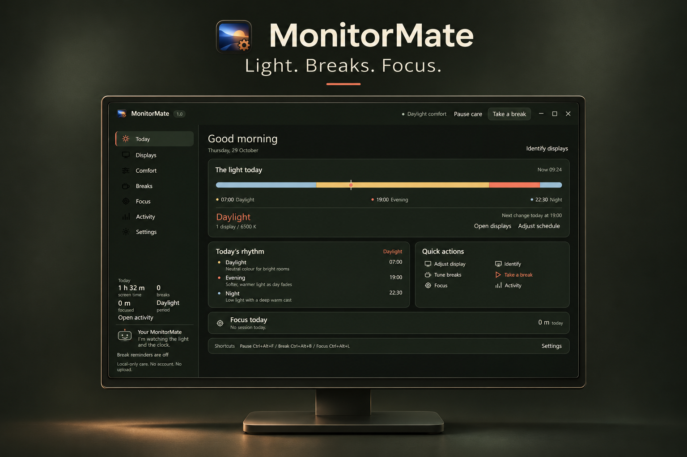
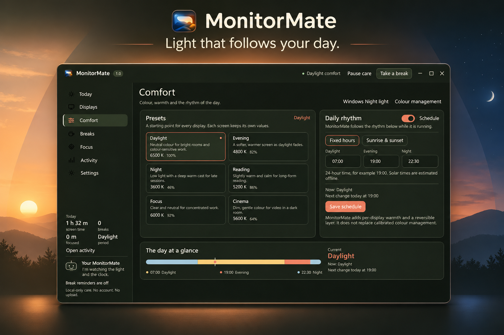
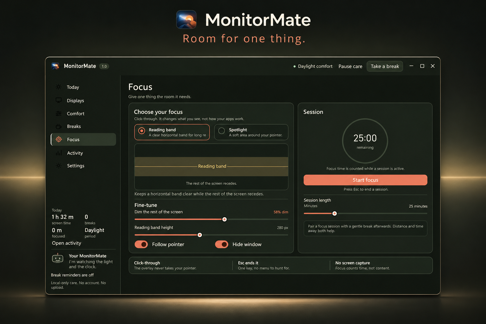

# Screenshot-derived promotional images

Generated 4 November 2026 with the built-in imagegen tool.

Exactly three final images. Inputs are the existing app captures from
`research/evidence/runtime/final`, visibly dated 29 October on Today.
No fresh app screenshot or hardware validation was performed for this set.

These are AI-generated promotional interpretations. Interface text, numerical
values, icon details and window geometry may differ from the authentic inputs.
For example the Comfort illustration changes the Cinema temperature readout.
Use original captures for Store screenshots, tutorials and QA evidence.

The supplied icon files and original screenshots were preserved.
Generation prompts and reference/output SHA-256 hashes are stored in
[manifest.json](images/manifest.json).

Design read: promotional desktop product illustrations for MonitorMate users,
in the existing olive-black instrument style. Energy 1, rhythm 2, motion 1.
The app window is the focal point; surrounding light supports each feature.

## Overview

Reference: [docs/screenshots/today.png](screenshots/today.png).

Output: 1536 by 1024 PNG. This is generated art.

Full prompt:

Create one polished wide product promotional image, 1536x1024 if supported, for MonitorMate, a Windows display comfort utility. Reference image is an authentic app screenshot, use its exact app identity, icon, olive-black, ivory, persimmon, sand and celadon palette. Show a large crisp front-facing app window containing the referenced Today page, preserve visible layout and controls as faithfully as possible. Frame it on an understated olive-black studio background with subtle physical monitor-inspired material and generous margins. Editorial typography outside the screenshot: 'MonitorMate' and 'Light. Breaks. Focus.' only. No fake users, performance statistics, ratings, medical claims, extra features or logos. The screenshot is reference material, do not depict the promotional composition as a real app capture. Refined compact desktop instrument feeling. One clear focal point, ivory lettering, restrained persimmon accent, no neon, no decorative grid.

## Comfort

Reference: [docs/screenshots/comfort.png](screenshots/comfort.png).

Output: 1536 by 1024 PNG. This is generated art.

Full prompt:

Create one polished wide product promotional image, 1536x1024 if supported, for MonitorMate using the supplied authentic Comfort page screenshot as reference. A large crisp front-facing Comfort app window should dominate, faithfully preserve six presets and daily rhythm controls, original MonitorMate icon and identity. Olive-black background, ivory type, restrained warm persimmon and sand accents inspired directly by the app. Place outside-window heading 'MonitorMate' and subtitle 'Light that follows your day.' Arrange subtle warm-to-cool environmental lighting behind the window to express daylight, evening and night without inventing functionality. No medical benefit claims, no badges, no fake statistics, no testimonials, no new UI. This is a promotional illustration based on a screenshot, not evidence of a running app.

## Focus

Reference: [docs/screenshots/focus.png](screenshots/focus.png).

Output: 1536 by 1024 PNG. This is generated art.

Full prompt:

Create one polished wide product promotional image, 1536x1024 if supported, for MonitorMate using supplied authentic Focus page screenshot as reference. Preserve original app identity, icon, dark olive and ivory interface, persimmon accent, reading band preview and 25:00 session ring. Large crisp front-facing app window occupies most composition. Refined dark desk-instrument framing with a quiet horizontal pool of light echoing reading band, no desk clutter. Editorial text outside the app: 'MonitorMate' and 'Room for one thing.' only. Do not invent features, medical benefits, usage metrics, awards, testimonials or UI. Preserve screenshot layout as faithfully as possible. A promotional illustration based on screenshot, not a runtime verification image.

## Fourth README visual

The [README](../README.md) now includes four visuals: the three generated images
above and [the authentic Today capture](screenshots/today.png), copied without
editing from the saved research capture. No fourth image was generated.
The authentic PNG is 1040 by 650; the promotional PNGs are 1536 by 1024.
Public copies of all app-page captures are in [screenshots](screenshots).
The manifest omits machine-specific generated-image paths but preserves prompts
and reference/output hashes. No trial-expiration visual was added.
